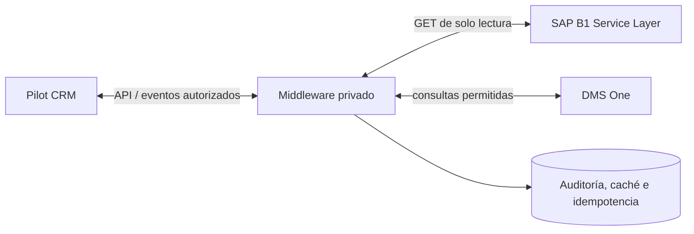

# Pilot CRM API — documentación e integración SAP Business One / DMS One

Repositorio de referencia para el uso de la API de **Pilot CRM** y la documentación de integración con **SAP Business One (Service Layer)** y **DMS One**. Los ejemplos de este repositorio son educativos y deben ejecutarse exclusivamente con credenciales y registros de prueba autorizados.

> **Estado:** documentación y ejemplos de API. **No contiene el código fuente del middleware interno YUDE Pilot V7.1 ni constituye una implementación productiva.** El middleware debe mantenerse en un repositorio **privado** separado.

## Índice

1. [Alcance](#alcance)
2. [Arquitectura de referencia](#arquitectura-de-referencia)
3. [Autenticación Pilot](#autenticación-pilot)
4. [Mapa de ejemplos](#mapa-de-ejemplos)
5. [Seguridad](#seguridad)
6. [Middleware SAP / DMS / Pilot](#middleware-sap--dms--pilot)
7. [Pruebas y validación](#pruebas-y-validación)

## Alcance

- Ejemplos de autenticación y consulta de catálogos, prospectos/leads y eventos de Pilot.
- Contratos de referencia y pautas para consumir la API de Pilot.
- Diseño de integración, límites operativos, trazabilidad y medidas de protección.
- Este repositorio **no es documentación oficial del proveedor**; confirmar métodos, nombres de `FlowName`, límites y campos contra la documentación vigente de Pilot.

## Arquitectura de referencia



**Política de integración:** en SAP productivo usar únicamente autenticación, consultas de lectura y cierre de sesión; las escrituras requieren pruebas y autorización independiente en una empresa TEST. No interpretar los ejemplos de actualización de leads como habilitación de escrituras en SAP.

## Autenticación Pilot

Base de API identificada en los ejemplos históricos: `https://api.pilotsolution.net/v1`. Se deben utilizar variables de entorno o un gestor de secretos, **nunca credenciales dentro de Git**.

```bash
export PILOT_USERNAME="usuario-de-pruebas@example.invalid"
# Proveer la clave de forma segura, fuera del shell history
read -rsp "Clave Pilot: " PILOT_PASSWORD; echo
export PILOT_PASSWORD

# Script de autenticación (requiere curl, jq y variables anteriores)
bash autorizacion.bash
```

El endpoint histórico usa parámetros `username` y `password` en la URL. Por tanto, revisar exposición en registros de proxies, historial de comandos y herramientas de observabilidad; usar el mecanismo más seguro soportado por el proveedor. El script ya no imprime ni persiste tokens.

## Mapa de ejemplos

| Archivo / carpeta | Objetivo |
|---|---|
| `autorizacion.bash` | Autenticación con credenciales suministradas en tiempo de ejecución |
| `Peticion-dato-Maestro.bash` | Ejemplos de consulta de datos maestros (revisar payload y valores antes de ejecutar) |
| `propescts.bash` | Ejemplos históricos de prospectos |
| `leads/bash/` | Lectura y operaciones de leads; **no ejecutar escrituras con datos reales sin autorización** |
| `leads/doc/` | Notas de operaciones de leads |
| `estructura/estructura.md` | Estructura del sobre de solicitud |
| `docs/INTEGRACION_SAP_DMS_PILOT.md` | Arquitectura y políticas del middleware |

Los ejemplos heredados pueden contener valores ilustrativos y contratos desactualizados: no están certificados contra una instancia en vivo.

## Seguridad

Consultar [SECURITY.md](SECURITY.md) para el tratamiento de credenciales expuestas, rotación, historial Git y revisión de datos.

**Nunca incluir:** contraseñas, tokens, cookies, archivos `.env`, bases de datos, VIN y datos personales reales, registros de SAP o direcciones internas.

## Middleware SAP / DMS / Pilot

La línea de desarrollo interna recuperada comprende V4, V5, V6.3 y V7.1. Su implementación Python/FastAPI, reglas de escritura TEST, caché y auditoría pertenecen a un repositorio privado distinto. Aquí solo documentamos interfaces y buenas prácticas no sensibles: [integración](docs/INTEGRACION_SAP_DMS_PILOT.md).

## Pruebas y validación

Revisiones recomendadas antes de cada PR:
- Escaneo de secretos (Gitleaks u herramienta equivalente) y revisión humana del diff.
- Comprobación de sintaxis de ejemplos Bash y documentación Markdown.
- Pruebas con fixtures sintéticos, sin conectividad a producción.
- Validación de límites, reintentos, idempotencia y manejo de códigos HTTP con el proveedor.

**Aviso:** las pruebas de middleware local reportadas previamente no equivalen a pruebas ejecutadas en este repositorio ni a certificación de integración productiva.


## Especificaciones y auditoría V7.1

La documentación siguiente distingue la implementación examinada de los requisitos futuros. **El código interno del middleware no se aloja en este repositorio público.**

| Documento | Contenido |
|---|---|
| [PRD — Requisitos de producto](docs/PRD_INTEGRACION_PILOT_SAP.md) | Objetivos, usuarios, requisitos, alcance, criterios de aceptación y fases |
| [TRD — Diseño técnico](docs/TRD_INTEGRACION_PILOT_SAP.md) | Arquitectura, contratos, persistencia, seguridad, pruebas y condiciones de salida |
| [APP Flow](docs/APP_FLOW_INTEGRACION_PILOT_SAP.md) | Navegación, onboarding, snapshots, reservas y manejo de errores |
| [Auditoría V7.1](docs/AUDITORIA_FUNCIONAL_V7_1.md) | Qué existe, qué se verificó localmente, deuda P0/P1 y límites de evidencia |

**Resultado de auditoría local:** 27/27 pruebas aisladas aprobadas. No se ha verificado el comportamiento frente a Pilot, SAP o DMS productivos. La actualización de reserva inbound histórica está deprecada y retorna HTTP 410.

## Mantenimiento

Abrir un PR para cambios en contratos, ejemplos o documentación y revisar implicaciones de seguridad. Evitar subir paquetes ZIP completos de middleware al repositorio público.
