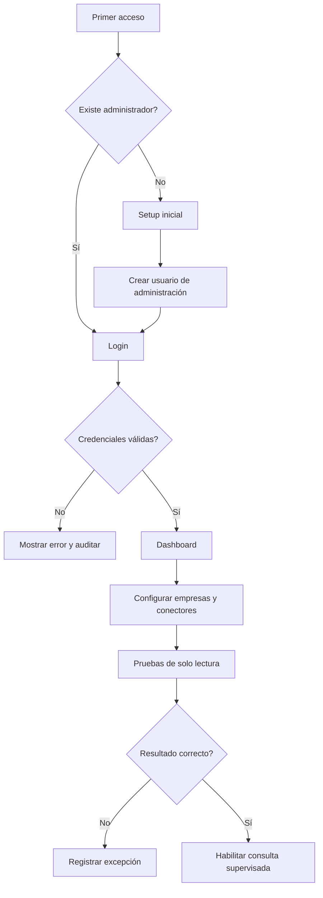
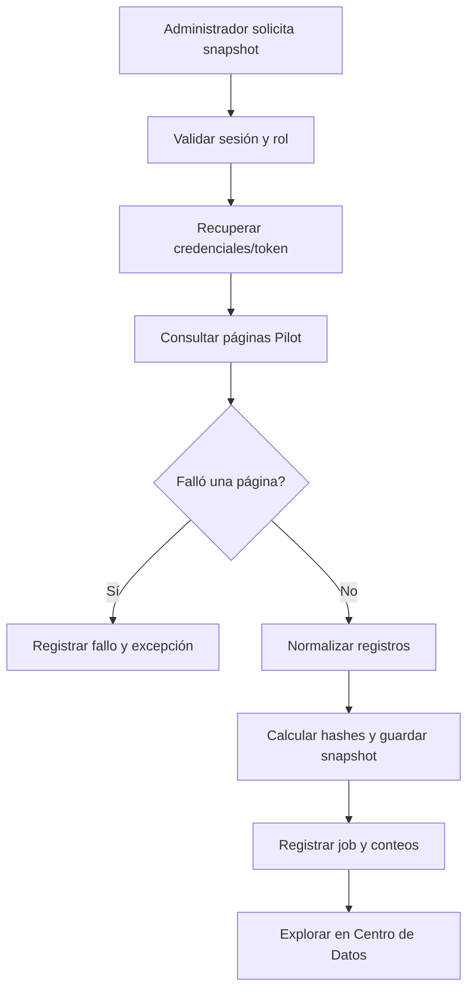
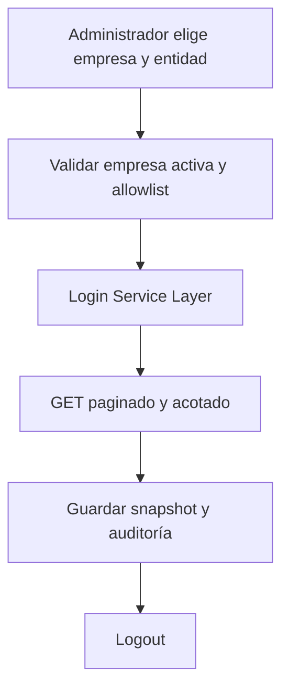
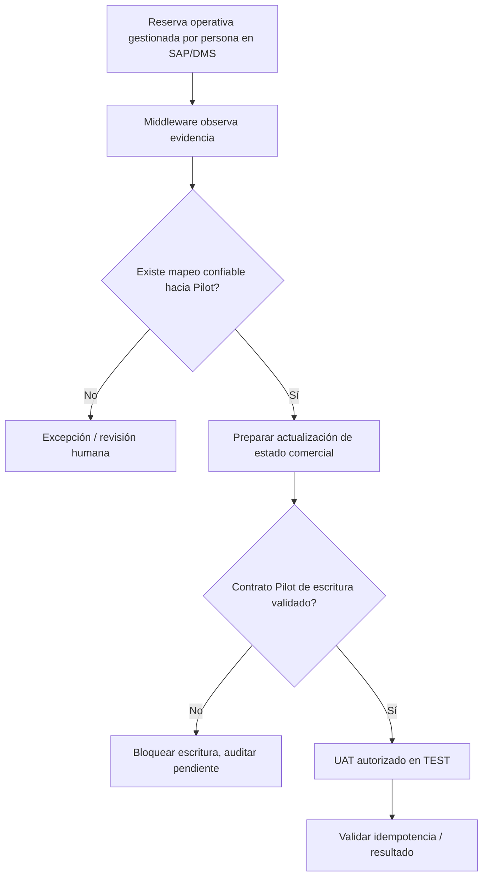

# APP FLOW — Pilot CRM / SAP Business One / DMS One

**Versión de referencia:** V7.1 (laboratorio). Se distinguen los flujos observados en código de los flujos futuros propuestos.

## 1. Onboarding y seguridad



**Observado:** rutas `/setup`, `/login`, `/`, `/companies`, `/pilot`, `/pilot/test`.  
**Pendiente:** endurecer autenticación, segregación de roles, protección CSRF y gestión de secretos.

## 2. Navegación del laboratorio

```text
Dashboard
 ├─ Empresas SAP → Editar → Comprobar conexión
 ├─ Pilot → Configuración → Test token / Stock / Ventas
 │    └─ Observador → Ejecutar sondeo → Revisar históricos
 ├─ Vehículos → Buscar → Evidencia normalizada
 ├─ Centro de datos V7 → Filtrar snapshots → Revisar registro
 ├─ Mappings V7 → Ver → Administrador edita → Auditoría
 ├─ Capacidades V7 → Ver contratos y estado
 ├─ Laboratorio de reservas TEST → DRY-RUN / control explícito
 ├─ Integración / trazabilidad
 ├─ Auditoría / logs / transacciones
 └─ Sistema / usuarios
```

Las pantallas existen en el código, pero la sola presencia de una ruta no demuestra completitud funcional o preparación para producción.

## 3. Snapshot Pilot — implementado con limitaciones



**Riesgo:** confirmar paginación completa, reintentos, rate limit y distinguir cobertura parcial de completa.

## 4. Snapshot SAP — implementado con límites



**Regla:** todas las lecturas requieren empresa seleccionada explícitamente. Un snapshot acotado **no** es una réplica completa de SAP.

## 5. Flujo comercial de reserva — diseño de negocio



**No implementado como flujo productivo automático:** el antiguo endpoint Pilot → SAP de reserva retorna **HTTP 410** y declara deprecación. Ninguna pantalla debe sugerir que ya se sincronizan reservas operativas.

## 6. Reconstrucción de incidentes
1. Buscar job o evento por correlación, origen, entidad y compañía.
2. Revisar `timestamp`, hash de entrada, estado, página/checkpoint, intento y error.
3. Comparar evidencia SAP/Pilot sin exponer datos completos.
4. Identificar mapeo ausente o contrato incongruente.
5. Repetir únicamente en TEST o reconsultar en lectura, con aprobación.

## 7. Estados UX recomendados

| Estado | Etiqueta | Acción |
|---|---|---|
| No configurado | Sin credenciales/empresa | Configurar |
| Disponible | Conector autenticado y lectura validada | Consultar |
| Parcial | Snapshot limitado / fuente incompleta | Revisar cobertura |
| Pendiente | Falta contrato o revisión humana | No sincronizar |
| Bloqueado | Política de escritura / entorno no permitido | Mostrar motivo |
| Error | Fallo controlado y auditable | Consultar incidente |

## 8. Flujo futuro propuesto
- Reconciliación automática de evidencias de contratos, pagos y facturas en **solo lectura**.
- Unificación de jobs manuales y programados.
- Cola de excepciones con aprobaciones y reversión.
- Pantallas accesibles con indicadores de vigencia, completitud y origen del dato.

## 9. Criterios de revisión UX
Pruebas de navegación, permisos de administrador, estados vacíos, mensajes de error, confirmaciones, cancelación y accesibilidad; validar con usuarios de TI, operaciones y auditoría antes del cierre de fase.
